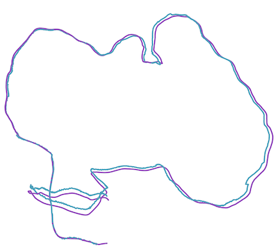

**Nanoslam** is a 100% human-written, minimalist, simple yet accurate monocular SLAM in under 800 lines of Python.


**Why?** I wanted to learn about SLAM, but couldn't find any simple yet complete implementation in Python. Most examples only implement VO (Visual Odometry) and use ground truth to gain accuracy.


**Getting started:** Make a directory `datasets`, download the `fr3/long_office_household` from [TUM RGB-D dataset download page](https://cvg.cit.tum.de/data/datasets/rgbd-dataset/download#freiburg3_long_office_household) and extract it.

```
uv sync
uv run python nanoslam.py household --rerun
```


**How it works:** it uses GFTT for keypoint/feature detection and Lucas-Kanade for tracking. To initialize, it triangulates points after enough parallax, using relative pose from `poselib`. On every subsequent frame, it finds the current position using PnP from `poselib`, and relocalizes using 3D points from recent frames. After each keyframe, it creates new 3D points and performs local Bundle Adjustment using *Ceres* via `pycolmap`.

The main loop (implemented in `on_frame`) is really simple, you should read it!

This algorithm is inspired by [OV²SLAM](https://arxiv.org/abs/2102.04060) but significantly simplified. It doesn't feature loop closure via place recognition but relocalization can be adapted to perform loop closure by reprojection of old 3D points. Still, it is accurate enough to complete `fr3/long_office_household` with a drift of only 7cm.  The current parameters are somewhat fine-tuned to that sequence but with a few tweaks, it can be generalized.


<p align="center"><p>


**Licence:** 0BSD (equivalent to public domain)